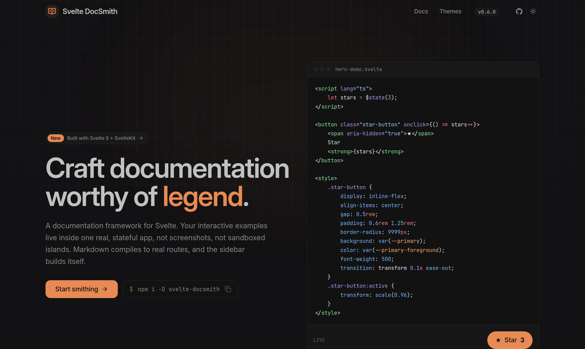

# Svelte DocSmith

[](https://www.npmjs.com/package/svelte-docsmith)
[](https://opensource.org/licenses/MIT)

<p align="center">
  
</p>

The documentation framework for Svelte 5 library authors whose interactive
examples need to live inside one real, stateful SvelteKit app, not sandboxed as
isolated islands.

Write a markdown file under `src/routes/docs/` and you get a styled page with
syntax highlighting, heading anchors, a sidebar derived from your content, and a
live table of contents. No per-page wiring, no content collection to configure.

> **Status: pre-1.0.** Published to npm and usable today. Minor releases may still
> include breaking changes until v1.0.
>
> **What 1.0 will lock.** Authoring components, `DocsShell`, `ErrorPage`,
> the `docsmith()` options, the sitemap / llms / feed
> route handlers, the search engine, and the theming contract — ordinary semver,
> breaking changes ride a major.
>
> **What stays experimental.** Versioning: `DocsVersions`, the archive marker,
> and the `archive-version` command. Generated props tables: `?props` imports
> and `PropsTable`'s `of`. The MCP server: `mcpServer` and the
> `site.mcp` field. Agent markdown: the props tables and example code written
> into `llms-full.txt` and `.md` pages. They may still change in a minor until
> authors have used them for real.

## Install

The fastest way to start a new docs site is the scaffolder, which wires up
everything below for you:

```bash
npm create svelte-docsmith@latest my-docs
```

To add DocSmith to an existing SvelteKit app, install the package instead:

```bash
npm install svelte-docsmith
```

Peer dependencies: Svelte 5, SvelteKit 2 or 3, and Tailwind v4, set up the
standard way in your app.

## Setup

Two small pieces, once.

**1. Vite.** DocSmith is one Vite plugin, `docsmith()` from
`svelte-docsmith/vite`, and it is the only place your docs are configured. It
compiles your `.md` pages (mdsvex, Shiki highlighting coloured by your theme
and a generous language set, heading anchors, and the packaged page
layout), scans their frontmatter into the `svelte-docsmith/content` module (so
the sidebar is derived from content, never hand-written), builds the search
index, powers `LiveExample`, and serves your site config to the shell and the
route handlers. It goes before `sveltekit()`:

```ts
// vite.config.ts
import adapter from '@sveltejs/adapter-auto';
import { sveltekit } from '@sveltejs/kit/vite';
import { vitePreprocess } from '@sveltejs/vite-plugin-svelte';
import tailwindcss from '@tailwindcss/vite';
import { docsmith } from 'svelte-docsmith/vite';
import { defineConfig } from 'vite';

export default defineConfig({
	plugins: [
		docsmith({
			site: { title: 'My Library', github: 'https://github.com/you/my-library' }
		}),
		tailwindcss(),
		sveltekit({
			extensions: ['.svelte', '.md'],
			preprocess: [vitePreprocess()],
			adapter: adapter()
		})
	]
});
```

On SvelteKit 2, `extensions` and `preprocess` go in `svelte.config.js` instead,
and `sveltekit()` takes no options.

By default it scans `src/routes/docs`; pass `content: 'src/routes/guide'` to
point elsewhere. The theme, markdown options, versions, the changelog and link
checking all go in the same call.

**2. The stylesheet.** In your root `app.css`, once Tailwind v4 is set up the
standard way (`tailwindcss` + the `@tailwindcss/vite` plugin, stylesheet imported
in the root layout), the whole style contract is one import:

```css
@import 'tailwindcss';
@import 'svelte-docsmith/theme.css';
```

`theme.css` makes Tailwind scan the package, registers the shadcn design tokens
(`--background`, `--primary`, `--radius`, …) and pulls in the typography and
animation plugins. The tokens' values come from your theme, chosen in
`docsmith()` (see [Themes](#themes)); redefine any token in `app.css` and it
wins.

## The shell

Add `DocsShell` once, in `src/routes/docs/+layout.svelte`. It composes the
header, sidebar, content area, and table of contents. `content` is the generated
content index, so there is no content collection to import and no alias to
configure, and the shell reads your `site` options itself:

```svelte
<script lang="ts">
	import { DocsShell } from 'svelte-docsmith';
	import { content } from 'svelte-docsmith/content';

	const { children } = $props();
</script>

<DocsShell {content}>
	{@render children()}
</DocsShell>
```

## Doc pages

Each page is a `+page.md` under `src/routes/docs/`. Frontmatter drives the
sidebar and the `<h1>`; the body is markdown, starting at `##`:

````md
---
title: Getting Started
description: Install and configure the library.
section: Guides
order: 1
---

## Installation

```bash
npm install my-library
```
````

`title` names the page. `section` groups pages in the sidebar; `order` sorts
within a group (and orders the groups by their smallest `order`). Add the file
and it appears in the sidebar, styled, highlighted, with a table of contents.

## Live examples

`LiveExample` renders a real, interactive component next to its own
syntax-highlighted source: one file, imported twice, so the demo and its code
can never drift. The `?source` import is served by the same `docsmith()` Vite
plugin you already added:

```svelte
<script>
	import { LiveExample } from 'svelte-docsmith';
	import Counter from '#lib/examples/counter.svelte';
	import counterSource from '#lib/examples/counter.svelte?source';
</script>

<LiveExample source={counterSource}>
	<Counter />
</LiveExample>
```

To type the `?source` import, reference the package's client types once in
`src/app.d.ts`:

```ts
/// <reference types="svelte-docsmith/client" />
```

## Props tables from your types

`PropsTable` can read a component's API straight from its typed `$props()`, so
the reference can't drift from the code either. Import the component with
`?props` and pass it to `of`:

```svelte
<script>
	import { PropsTable } from 'svelte-docsmith';
	import buttonProps from '#lib/button.svelte?props';
</script>

<PropsTable of={buttonProps} />
```

Types come from the TypeScript checker (an imported `ButtonVariant` alias shows
its values), descriptions from JSDoc, defaults from the destructuring. Snippets,
callbacks and `$bindable()` props all get rows, and inherited HTML attributes
collapse to one line. It needs the optional peers `typescript` and `svelte2tsx`
(`npm i -D typescript svelte2tsx`). Generated props tables are **experimental**:
outside the 1.0 promise for now.

## Batteries included

- **Search.** A ⌘K / Ctrl-K command palette over a build-time full-text index, no
  service to host. Pass a `search` loader to `DocsShell`:
  `search={() => import('svelte-docsmith/search').then((m) => m.docs)}`.
- **SEO.** `DocsShell` writes `<title>`, meta description, canonical, and Open
  Graph / Twitter tags for every page from its frontmatter, no per-page wiring.
- **OG images.** `ogImages()` draws every doc page its own 1200×630 share image
  at build time (title, description and section in your theme's colours), and
  `site.ogImages` points each page's head at it. Needs the optional `satori` and
  `@resvg/resvg-js` peer dependencies.
- **Error pages.** `ErrorPage` gives a styled 404 that keeps the site chrome;
  drop it into a SvelteKit `+error.svelte`.
- **Broken-link check.** `vite build` fails when a doc page links to a docs path
  with no page, or to an anchor the page doesn't have, and lists every one with
  its file and line; `vite dev` warns. Paths a Worker or proxy serves beside the
  app go in `links: { outside }`, so links to them pass the check and render
  `rel="external"` for SvelteKit's crawler and router.
- **Versioned docs.** Declare `versions` on the Vite plugin, freeze a release
  with `npx svelte-docsmith archive-version <id>`, and `DocsShell` picks the
  manifest up from the `content` it already takes. The sitemap and llms route
  handlers keep to the current version.
- **Changelog.** Point the plugin at your `CHANGELOG.md`; import the parsed
  releases from `svelte-docsmith/changelog`, render them with `Changelog`, and
  serve an Atom feed with `changelogFeed()`.
- **Mermaid.** A mermaid code fence is rendered client-side (optional `mermaid`
  peer dependency, loaded only on pages that need it).
- **Landing sections.** `Hero`, `FeatureGrid`, `Feature`, `CTA`, and `Action`
  for the marketing page in front of your docs.
- **Route handlers.** `svelte-docsmith/server` serves `sitemap.xml`, `llms.txt`
  / `llms-full.txt`, the `.md` page twins, OG images, the changelog Atom feed
  and the MCP server, each one line in a `+server.ts` that reads your site config itself.
- **Components.** `Callout`, `Tabs`, `Steps`, `Card`, `Accordion`, `Badge`,
  `Kbd`, `FileTree`, `PropsTable`, and more, authored right inside markdown.
- Heading anchors, a scroll-spy table of contents, and one-click copy on every
  code block, wired up for you.

## Themes

A theme is the whole look in one CSS file: colours, radius, fonts, shadows and
code colours, for light and dark. Eleven presets ship in the box, and
**Darkmatter** is the default. Choose another by name, or point at a theme file
of your own (a theme exported from [tweakcn](https://tweakcn.com/) works as is):

```ts
docsmith({ site: { title: 'My Docs' }, theme: 'amethyst' }); // or theme: './src/theme.css'
```

Available: `darkmatter`, `tangerine`, `amethyst`, `graphite`, `evergreen`,
`rose`, `ocean`, `nord`, `claude`, `bubblegum`, `mono`. Code blocks follow the
theme; set `codeTheme: { light, dark }` to use an exact Shiki pair instead.

## What's exported

| Entry point                    | What it is                                                                                                                                |
| ------------------------------ | ----------------------------------------------------------------------------------------------------------------------------------------- |
| `svelte-docsmith`              | Components (`DocsShell`, `Changelog`, landing sections, `LiveExample`, `Callout`, …), `defineConfig`, `createSearchEngine`, and the types |
| `svelte-docsmith/server`       | route handlers: `sitemap`, `changelogFeed`, `llmsTxt`, `llmsFullTxt`, `agentMarkdown`, `ogImages`, `mcpServer` (server-only)              |
| `svelte-docsmith/preprocess`   | `docsmith()`, the mdsvex/Shiki pipeline (Node, config time)                                                                               |
| `svelte-docsmith/vite`         | `docsmith()`, the content / search / llms / changelog indexes and `?source` / `?props` transforms (Node, build)                           |
| `svelte-docsmith/content`      | `content` (`{ docs, versions }`) for `DocsShell`, the generated sidebar content index and version manifest                                |
| `svelte-docsmith/search`       | `docs`, the generated full-text search index (lazy-load it)                                                                               |
| `svelte-docsmith/llms`         | `docs`, the generated agent markdown index (read by the route handlers)                                                                   |
| `svelte-docsmith/changelog`    | `releases`, the generated changelog index (parsed from `CHANGELOG.md`), and `changelogPath`                                               |
| `svelte-docsmith/mermaid`      | the Mermaid diagram component (lazy-loaded by the preprocessor when a mermaid fence is present)                                           |
| `svelte-docsmith/client`       | ambient types for `?source` and `?props` imports (reference it from `src/app.d.ts`)                                                       |
| `svelte-docsmith/theme.css`    | the base style contract                                                                                                                   |
| `svelte-docsmith/themes/*.css` | the eleven presets, as theme files (choose one with `docsmith({ theme })`)                                                                |

The package also ships a CLI binary with two commands:

- `npx svelte-docsmith archive-version <id>` freezes the current docs into a
  versioned archive.
- `npx svelte-docsmith theme` opens the theme builder and writes the theme you
  send from it to `src/theme.css`, setting `theme` in `docsmith()`. Pass
  `--link <theme link>` to write a shared theme link without the browser. See
  [Theming](https://docsmith.geodask.com/docs/theming#build-a-theme).

The vendored shadcn primitives and internal helpers (the TOC engine, clipboard
utility, markdown renderer map) are **not** part of the public API; they can
change between releases. Get buttons, cards, and the like from `shadcn-svelte`
directly.

## License

MIT. See [LICENSE](LICENSE).
