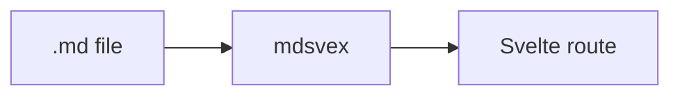

<script>
	import { Callout, FileTree, FileTreeItem } from 'svelte-docsmith';
</script>

## A page is a file

Every page is a `+page.md` file under `src/routes/docs/`. The directory name is
the URL, so this file serves `/docs/guides/routing`:

<FileTree>
	<FileTreeItem name="src" folder>
		<FileTreeItem name="routes" folder>
			<FileTreeItem name="docs" folder>
				<FileTreeItem name="guides" folder>
					<FileTreeItem name="routing" folder>
						<FileTreeItem name="+page.md" highlight />
					</FileTreeItem>
				</FileTreeItem>
			</FileTreeItem>
		</FileTreeItem>
	</FileTreeItem>
</FileTree>

Create the file, and the page exists.

## Frontmatter

The frontmatter block at the top of each page drives the sidebar through its
built-in fields:

| Field         | Required | Purpose                                                                    |
| ------------- | -------- | -------------------------------------------------------------------------- |
| `title`       | yes      | The sidebar label and page heading.                                        |
| `description` | no       | One-line summary, shown under the title.                                   |
| `section`     | no       | Sidebar group, a string or a nested path. Omitted pages fall under "Docs". |
| `order`       | no       | Sort key within the group.                                                 |
| `lastUpdated` | no       | The day the page last changed, `YYYY-MM-DD`. Git supplies it otherwise.    |

```md
---
title: Routing
description: How pages map to URLs.
section: Guides
order: 1
---
```

`section` names the group and `order` sorts within it; groups themselves are
ordered by the smallest `order` they contain.

### Nested sections

Give `section` an array to nest a page inside a collapsible subsection. Each
entry is one level of the group path:

```md
---
title: Middleware
section: [Guides, Advanced]
order: 2
---
```

This puts "Middleware" under a collapsible **Advanced** group inside **Guides**.
Nesting can go as deep as you like, `order` still sorts each level, and a
subsection inherits the smallest `order` of its pages. The branch holding the
current page is expanded on load; the rest start collapsed.

<Callout variant="warning" title="A missing page is almost always frontmatter">

A page with no `title` is skipped by the sidebar. If a page isn't showing up,
check its frontmatter before anything else: a stray indent or a typo'd key is
the usual culprit. The build warns about a key that looks like a typo of a
built-in one, and a [frontmatter schema](#validating-frontmatter) turns any
undeclared key into a build error.

</Callout>

### Custom fields

Any other key is a custom field, and it's yours. It reaches the content index as
`data` on that page's entry, so a custom layout or your own listing page can use
it:

```md
---
title: Middleware
section: Guides
draft: true
badge: New
---
```

```ts
import { docs } from 'svelte-docsmith/content';

const published = docs.filter((doc) => !doc.data?.draft);
```

`data` is untyped until you declare your fields, once, in `src/app.d.ts`:

```ts
// src/app.d.ts
declare module 'svelte-docsmith' {
	interface DocsCustomFields {
		draft?: boolean;
		badge?: string;
	}
}
```

The content index loads on every page, so keep custom fields small: a flag or a
label, not a paragraph. Search and `llms.txt` don't include them.

### Validating frontmatter

The built-in fields are always checked: `order: "2"` or a `title` that YAML
reads as a number fails the build with the page's path, instead of quietly
dropping the page from where you expected it. A custom key one letter away from
a built-in one, like `ordr` or `Title`, prints a warning, unless your schema
declares it.

To check your custom fields too, pass a `schema` to the
[`docsmith()` Vite plugin](/docs/configuration#docsmith). Any
[Standard Schema](https://standardschema.dev) works: Zod, Valibot, ArkType and
others. It sees only the custom fields, so list just yours. Make it strict and
any key you didn't declare, typo or not, fails the build.

Keep the schema in its own module, so the config can check with it and
`app.d.ts` can take its types from it, and you declare each field once:

```ts
// src/lib/frontmatter.ts
import { z } from 'zod';

export const customFields = z.strictObject({
	draft: z.boolean().optional(),
	badge: z.string().optional()
});
```

```ts
// vite.config.ts
import { customFields } from './src/lib/frontmatter';

docsmith({ site, schema: customFields });
```

```ts
// src/app.d.ts
import type { z } from 'zod';
import type { customFields } from '$lib/frontmatter';

declare module 'svelte-docsmith' {
	interface DocsCustomFields extends z.infer<typeof customFields> {}
}
```

Every page with a frontmatter block is checked, and one error lists every
problem on every page. The schema only validates: custom fields reach `data`
as written, so leave transforms and defaults out of it.

## Headings

Don't write an `#` (h1) in the body. The `title` from frontmatter is the page
heading, so start your content at `##`. Every heading gets an anchor id
automatically, and the in-page table of contents is built from `##` and `###`
headings as the page renders.

## Code blocks

Fenced code blocks are highlighted by Shiki at build time; tag the fence with a
language. To emphasise a line, append the comment `// [!code highlight]` to it
(a real comment in that language). Shiki strips the comment and highlights the
line, like the second line below:

```ts
const docs = loadDocs();
const current = docs.find((d) => d.active); // [!code highlight]
```

Unknown language tags fall back to plain text rather than failing the build, so
an unfamiliar fence won't break your site.

Line highlighting is just the start. See [Code blocks](/docs/code-blocks) for
diffs, focus, error and warning lines, and word highlighting.

## Diagrams

Tag a fence `mermaid` and it renders as a diagram instead of code, via
[Mermaid](https://mermaid.js.org), following the site's light and dark themes:

````md

````

renders as:


Mermaid runs in the browser, so add it to your project. It's an optional peer
dependency, pulled in only on pages that use it:

```bash
npm i -D mermaid
```

A diagram is only as readable as its labels for anyone using a screen reader.
Give one an accessible name and description with Mermaid's `accTitle` and
`accDescr` directives, and both land in the rendered SVG:

````md

````

If a diagram fails to parse, or `mermaid` isn't installed, the source is shown
as a plain code block instead so the page never loses the content.

## Live examples

To show a real, running component next to its source, put the component in
`src/lib/examples/`. Import `LiveExample`, then import your component twice: once
as the component, and once with the `?source` query for its build-time
highlighted source. Pass both to `LiveExample`:

```md
<script>
  import { LiveExample } from 'svelte-docsmith';
  import Counter from '#lib/examples/counter.svelte';
  import counterSource from '#lib/examples/counter.svelte?source';
</script>

<LiveExample source={counterSource}>
  <Counter />
</LiveExample>
```

Both come from the same file, so the demo you render and the code you show can
never drift. See [Live Examples](/docs/live-examples) for a running one.

## Tabbed content

For alternatives such as package managers or framework variants, group blocks
with `Tabs` and `TabItem`. Pass the tab labels as `items`; each `TabItem`'s
`value` matches one label:

````md
<script>
  import { Tabs, TabItem } from 'svelte-docsmith';
</script>

<Tabs>
<TabItem label="npm">

```bash
npm i -D svelte-docsmith
```

  </TabItem>
  <TabItem label="pnpm">

```bash
pnpm add -D svelte-docsmith
```

  </TabItem>
</Tabs>
````

See the [Components](/docs/components/callout) section for the full set you can
drop into a page: callouts, steps, cards, accordions, file trees, badges, and
more.
